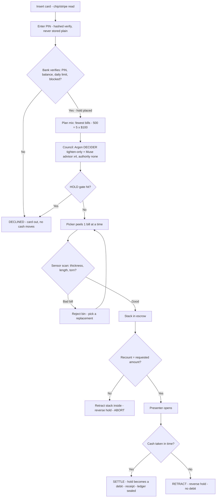
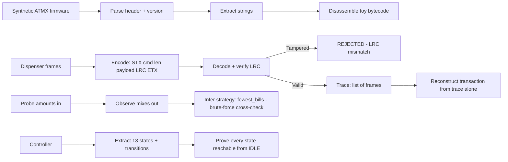
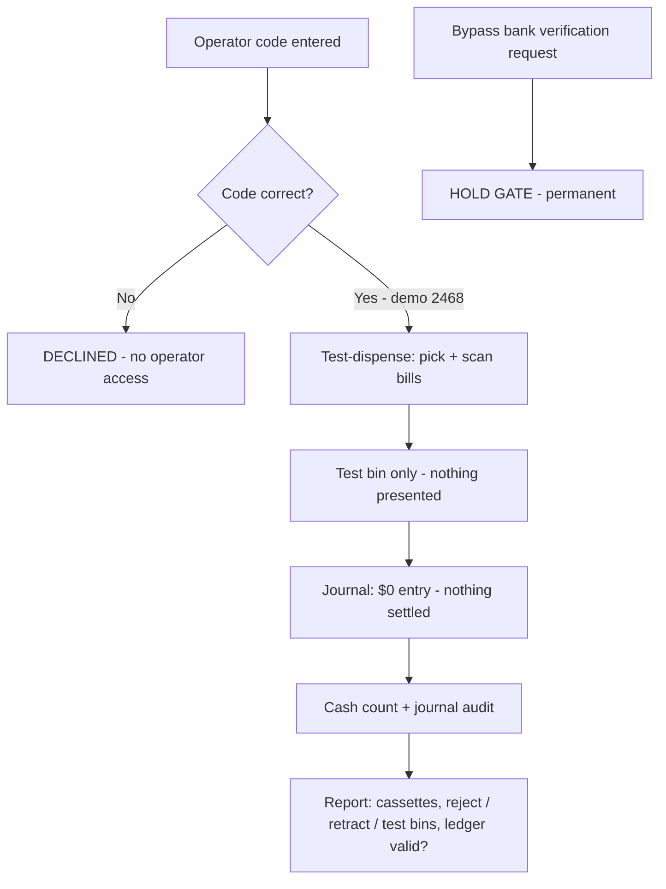
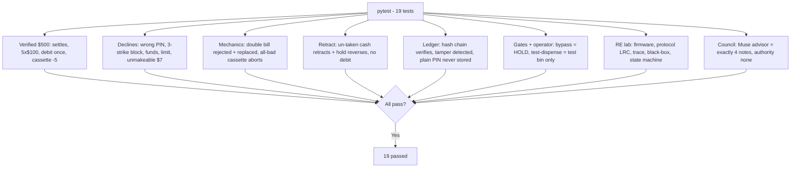
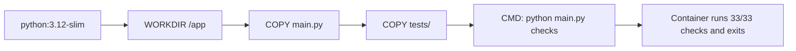

# atm-simulation-engine

**Inside an ATM, in code.** An educational ATM simulator and reverse-engineering lab — built from the transparent-ATM model video ("Inside an ATM: How cash actually gets dispensed!") — that shows, step by step, how an ATM verifies a transaction *before* any cash is allowed to move, then picks, scans, stacks, recounts, presents, settles — or retracts and reverses.

Project name in code: **ATM-SimX** · Repository: **kimanicollier44-cmyk/atm-simulation-engine**

Pure Python standard library. Zero dependencies. **Synthetic only:** fake accounts, fake PINs, fake bills, fake firmware, fake dispenser protocol. No real bank network, no real card data, no real cash hardware.

> Honest scope: this is a simulator and a teaching / reverse-engineering lab for its *own* synthetic artefacts. It does not connect to a bank, a payment network, a card reader, or ATM hardware, and it cannot dispense real cash. `bypass_bank_verification` is a permanent **HOLD** gate — see Owner / operator mode below.

---

## What is this?

An ATM is two machines in one box:

1. **An electronic verifier** — card reader, hashed PIN check, and a bank that must say YES (PIN correct, account real, balance enough, daily limit, fraud checks) and place a **hold** *before* any cash moves.
2. **A mechanical dispenser** — cash cassettes, a friction picker that peels **one bill at a time**, sensors that catch doubles, torn and wrong-length bills, an escrow stacker that **recounts** before presenting, and a presenter that **retracts** un-taken cash.

atm-simulation-engine models both halves in one file, with the failure paths included:

- Bad PIN → declined; **3 bad PINs block the card**
- Insufficient funds → declined at bank verification, nothing picks
- Daily limit → declined at bank verification
- Unmakeable amount ($7 from $10/$20/$50/$100 cassettes) → declined **before** picking
- Double / torn / short bill → diverted to the **reject bin**, a replacement is picked
- All-bad cassette → **abort + hold reversal**, nothing presented
- Cash not taken in time → **retract + hold reversal**, no debit
- Ledger tampering → detected by the **hash chain**

There is also a reverse-engineering lab that takes its own synthetic firmware, its own dispenser wire protocol, and its own transaction traces apart — legally, because every artefact is synthetic and belongs to this project.

And there is a legitimate **owner / operator mode**: owning an ATM gives you supervisor testing, not a bank-verification bypass. Bank verification belongs to the cardholder's bank and the payment network. Operator mode here does test-dispense into an internal test bin only — it presents no cash, debits no account, settles nothing, and writes a $0 journal entry.

---

## 🧰 Tech Stack Badges & Full Architecture Tech Stack


### Workflow badges (updated)

[](https://github.com/kimanicollier44-cmyk/atm-simulation-engine/actions/workflows/ci.yml)
[](https://github.com/kimanicollier44-cmyk/atm-simulation-engine/actions/workflows/docker-publish.yml)

> Workflow badges above are static shields linked to this repo's Actions pages. They become live run badges once the two workflow files under `.github/workflows/` are pasted into the repo (that paste step is the owner's — the GitHub App route cannot write workflow files). Until then the Actions pages will show no runs for those workflow names.

### 💻 Core Programming Languages & Core Systems

| Layer | What is used | Where |
|---|---|---|
| Language | Python 3.11+ (verified on 3.12) | `main.py`, `tests/test_atm_simx.py` |
| Runtime | CPython, standard library only — `argparse`, `hashlib`, `json`, `sys`, `dataclasses` | `main.py` |
| PIN security model | SHA-256 salted hash (`hash_pin`) — plain PIN is never stored | `Bank`, `Account` in `main.py` |
| Ledger | Append-only journal with a hash chain — tampering breaks verification | `Ledger` in `main.py` |
| State machine | 13 states, all reachable from `IDLE` | `extract_state_machine()` in `main.py` |
| Self-checks | Built-in checks suite, no test framework needed | `python main.py checks` → **33/33** |
| Tests | pytest suite | `tests/test_atm_simx.py` → **19 passed** |

Core systems inside the one file: `Bill` / `SensorArray` / `Cassette` (mechanics) · `Account` / `Card` / `Hold` / `Bank` (verification) · `Ledger` (journal) · `ATM` (controller) · dispenser wire protocol (frames + LRC) · synthetic firmware (`ATMX` header, strings, toy bytecode) · `ArgonDecider` + `MuseAdvisor` (council seats, offline stubs) · 13 HOLD gates.

### ⛓️ Web3 & Infrastructure

| Item | Status |
|---|---|
| Blockchain / Web3 | **None — not used, not claimed.** No chain, no wallet, no token, no smart contract. |
| Bank / payment network | **Modelled, not connected.** `Bank` is a synthetic in-process model of verification, holds, settle and reverse. No ISO 8583, no real processor, no network call. |
| Networking | **None at runtime.** Zero sockets, zero HTTP, zero external calls. The "wire protocol" is a synthetic byte framing for the RE lab, decoded locally. |
| Infrastructure | One process, one file, in-memory state. Demo state is rebuilt fresh on every run (`make_demo_atm()`). |

### ⚙️ Platform Support & Hardware Architecture

| Platform | Support |
|---|---|
| Linux | ✅ Primary — CLI and Docker |
| macOS | ✅ CLI (any Python 3.11+) |
| Windows | ✅ CLI (any Python 3.11+) |
| Docker | ✅ `python:3.12-slim` image, runs the checks suite by default |
| Real ATM hardware | ❌ **HOLD — never.** No cassette motor, picker, sensor, card reader, safe, or presenter is driven. Hardware is *modelled*: cassettes, picker, thickness / length / torn sensors, escrow stacker, reject / retract / test bins. |
| Demo hardware model | Cassettes: 20×$100, 20×$50, 40×$20, 40×$10 (capacity model 2,000 per cassette) · Bill length model: US bill 156 mm, accepted 150–162 mm |

### ⚡ Low-Level Infrastructure & Performance

| Item | Detail |
|---|---|
| Dispenser protocol | Synthetic framing: `STX (0x02) \| cmd (1 byte) \| len (1 byte) \| payload \| LRC \| ETX (0x03)` — LRC = XOR of cmd, len and every payload byte; a tampered frame is caught by its LRC |
| Firmware artefact | Synthetic `ATMX` image: header parse, strings extraction, toy-bytecode disassembly (`PICK 100, SCAN, STACK, PRESENT, SETTLE, HALT`); bad magic is rejected |
| Mix algorithm | Fewest-bills planning over available denominations (`_min_bills`), cross-checked in the RE lab by a brute-force reference (`_min_bills_bruteforce`) |
| Sensor model | Thickness (>1.5 = double, <0.7 = thin/partial), length (150–162 mm), torn flag |
| Performance | Deterministic, in-memory, no I/O in the transaction path — a full $500 run, the RE demos, and all 33 checks complete in well under a second on ordinary hardware. No benchmark numbers are claimed beyond that observed local run. |

### 🛠️ DevOps & Build Tools

| Tool | Use |
|---|---|
| GitHub Actions — CI | `.github/workflows/ci.yml` — checkout, Python 3.12, install pytest, run pytest, run `python main.py checks`. *Owner paste step — see Workflow badges note.* |
| GitHub Actions — Docker Publish | `.github/workflows/docker-publish.yml` — Buildx, Docker Hub login from repo secrets, build + push `credkellar/atm-simulation-engine:latest` on push to `main`. *Owner paste step.* |
| Docker | `Dockerfile` — `FROM python:3.12-slim`, copies `main.py` + `tests/`, default command runs the checks suite |
| pytest | Test runner for `tests/` (the only non-stdlib tool, and it is test-only — the app itself needs nothing) |
| Repo secrets needed | `DOCKERHUB_USERNAME` and `DOCKERHUB_TOKEN` **in this repository** — secrets do not carry over from other repos |

### ☁️ Cloud Providers

| Provider | Status |
|---|---|
| Cloud runtime | **None required.** Runs locally or in any container host. |
| Docker Hub | Target registry for the published image: `credkellar/atm-simulation-engine` (published only after the Docker Publish workflow is pasted *and* the two Docker Hub secrets above are set in this repo) |
| Gemini — Argon 4 Extended Thinking | **DECIDER seat, offline stub in code, names-only.** Risk-scores each simulated dispense; can only tighten, never lift a HOLD. No live call, no key in the repo. |
| Meta Model API — Muse | **Advisor seat, offline stub in code, names-only.** Exactly 4 advice notes per transaction, authority **none**, can never override a HOLD. No live call, no key in the repo. |
| Google Flow / other cloud seats | **None in this project.** Not claimed. |

---

## What this does?

### Step-by-step — a verified $500 withdrawal

1. **Insert card** — the chip/stripe read identifies the synthetic account (Alice, demo card).
2. **Enter PIN** — the PIN is verified against a salted SHA-256 hash. The plain PIN is never stored. A wrong PIN declines the transaction; 3 wrong PINs block the card.
3. **ATM asks the bank** — card, amount and the PIN result go to the synthetic `Bank` model.
4. **Bank verifies** — PIN result, account exists, balance ≥ $500, daily limit not exceeded, account not blocked.
5. **Hold placed first** — on YES, the bank places hold `HOLD-0001` for $500. **No cash has moved yet, and none can move before this step.**
6. **Plan the mix** — fewest-bills planning: $500 = **5 × $100**. An amount the cassettes cannot make exactly is declined here, before picking.
7. **Council check** — Argon 4 DECIDER risk-scores the simulated dispense (tighten-only); Muse advisor adds exactly 4 notes, authority none. A HOLD gate, if hit, stops the run.
8. **Picker peels one bill at a time** — the friction picker takes exactly one bill off the cassette stack per cycle, and a protocol frame is recorded for each pick.
9. **Sensor scan on every bill** — thickness, length and torn checks. A double, torn or short bill is diverted to the **reject bin** and a replacement bill is picked.
10. **Escrow stack + recount** — good bills stack in escrow and are recounted. If the recount is not exactly $500, the stack is retracted inside, the hold is **reversed**, and the transaction aborts — nothing is presented on a failed count.
11. **Presenter opens** — only a recounted, exact stack is presented.
12. **Take, or retract** — if the customer takes the cash, the hold **settles**: the account is debited exactly once ($2,000 → $1,500 for Alice) and a receipt is issued. If the cash is not taken, it **retracts** into the retract bin and the hold is **reversed** — no debit.
13. **Ledger entry, hash-sealed** — every step writes to the hash-chained journal, so later tampering with any entry is detected.

### Step-by-step — owner / operator mode

1. Enter the demo operator code (`2468` in the simulator).
2. **Test-dispense** cycles 2 × $100 into the internal **test bin** only.
3. Result is `TEST_ONLY` with a $0 journal entry — nothing presented, nothing settled, no account touched.
4. **Cash count + journal audit** reports cassette counts and value, reject / retract / test bin counts, and whether the ledger hash chain still verifies.

### Step-by-step — reverse-engineering lab

1. **Firmware RE** — build the synthetic `ATMX` firmware, parse its header and version, extract its strings, disassemble its toy bytecode; feed it bad magic and watch it be rejected.
2. **Protocol RE** — encode a dispenser frame, decode it back, then tamper with a byte and watch the LRC checksum catch it.
3. **Trace RE** — run a $500 withdrawal, take only its protocol trace, and rebuild the whole transaction from the trace alone: picks, rejects, amount stacked, presented?, settled?, reversed?
4. **Black-box RE** — probe the dispenser with amounts (500, 180, 90, 60, 40), observe only the mixes it returns, and infer its strategy — it answers `fewest_bills`, cross-checked against brute force.
5. **State-machine RE** — extract the controller's 13 states and transitions as data, and prove every state is reachable from `IDLE`.

### CLI — every command

```bash
python main.py checks            # full self-check suite (33 checks)
python main.py                   # same as checks (default)
python main.py withdraw --amount 500             # Alice (demo PIN 1234) takes $500
python main.py withdraw --amount 200 --no-take   # watch it retract + reverse
python main.py withdraw --amount 200 --user bob  # Bob (demo PIN 4321, $300 balance)
python main.py operator-test     # owner test-dispense into the test bin + cash count
python main.py re                # firmware / protocol / trace / black-box RE demos
python -m pytest tests/ -q       # pytest suite (19 tests)
```

Demo accounts (synthetic): **Alice** — $2,000 balance, PIN `1234`, $1,000/day limit. **Bob** — $300 balance, PIN `4321`, $1,000/day limit.

### HOLD gates (13)

`live_bank_network` · `real_cash_hardware` · `real_card_reader` · `store_plain_pin` · `bypass_pin` · **`bypass_bank_verification`** · `override_balance_check` · `dispense_without_authorization` · `disable_sensor_checks` · `disable_recount` · `open_safe` · `skip_retract_reversal` · `exceed_daily_limit`

---

## Add mermaid flowchart diagram per script

### `main.py` — transaction controller (bank, dispenser, ledger, council)



### `main.py` — reverse-engineering lab (firmware, protocol, trace, black-box, state machine)



### `main.py` — owner / operator mode



### `tests/test_atm_simx.py` — pytest suite



### `Dockerfile` — container build



---

## Why is this cool?

10 reasons this is cool:

1. **The $500 from the video, as running code** — every roller, sensor and bin in the transparent ATM has a job in the model, and you can watch it work in text.
2. **Verification-first is visible, not just claimed** — cash physically cannot move in the code before a hold exists; the order is enforced by the structure, not by a comment.
3. **The failure paths are the product** — rejects, aborts, retracts and reversals are all modelled and tested, not hand-waved. Most toy ATMs only show the happy path.
4. **A ledger that seals itself** — tamper with one journal entry and the hash chain breaks and says so. That is the real idea behind ATM journals, in 30 lines.
5. **A real RE lab with zero legal risk** — firmware, a wire protocol and traces you can take apart freely, because every artefact is synthetic and yours.
6. **Black-box probing teaches the real RE method** — inputs in, behaviour out, strategy inferred, then cross-checked against brute force. No source-peeking shortcut.
7. **The owner-mode line is taught honestly** — supervisor test-dispense is legitimate and built; skipping bank authorization is a permanent HOLD, with the reason stated plainly.
8. **One file, zero dependencies** — the whole machine — bank, dispenser, protocol, firmware, council, CLI, checks — is a single 962-line `main.py` that runs anywhere Python does.
9. **Deterministic and testable** — synthetic faults are injected by stack position, so a double bill or a torn bill happens on demand, every run, and 19 pytest tests + 33 self-checks prove the behaviour.
10. **A 13-state machine you can extract and prove** — the controller's states come out as data, and the checks prove every single one is reachable from `IDLE`. No dead states hiding in the machine.

---

## What problems this solves?

10 solutions:

| # | Problem | Solution in this project |
|---|---|---|
| 1 | "How does an ATM actually work?" is usually answered with a hand-wavy diagram | A step-by-step executable model: card → PIN → bank hold → pick → scan → stack → recount → present → settle, each step printed as it happens |
| 2 | Tutorials skip what happens when something goes wrong mid-dispense | Every failure path is modelled: bad PIN, 3-strike block, insufficient funds, daily limit, unmakeable amount, bad bills, all-bad cassette, un-taken cash |
| 3 | Cash could be shown "dispensing" before authorization in naive demos | Hold-first design: the bank hold is placed and recorded before the picker is ever called; dispense-without-authorization is a HOLD gate |
| 4 | Double or damaged bills would silently make a payout wrong | Per-bill sensor scan (thickness / length / torn) diverts bad bills to the reject bin and picks replacements; escrow recount must match exactly or the run aborts |
| 5 | Un-taken cash is a real-world loss / dispute case | Presenter timeout path retracts the stack to the retract bin and reverses the hold — the account is never debited for cash it did not take |
| 6 | ATM journals are trusted blindly in most teaching material | Hash-chained ledger: `operator_cash_count` and the checks verify the chain, and a tamper test proves a changed entry is detected |
| 7 | PIN handling is often taught with plain-text storage | Salted SHA-256 PIN hashes only; a dedicated check proves the plain PIN appears nowhere in stored account state |
| 8 | RE beginners have nothing safe to practise firmware / protocol RE on | Synthetic `ATMX` firmware + synthetic frame protocol with LRC: parse, extract, disassemble, tamper and catch — all on artefacts made for exactly this |
| 9 | "How do you know the mix is optimal?" is rarely answered | Black-box inference recovers the `fewest_bills` strategy from probes alone, and a brute-force reference confirms the mixes are truly minimal |
| 10 | ATM owners are told online that buying a machine lets them bypass bank checks | Operator mode shows what ownership *actually* grants — test-dispense to an internal bin, cash counts, journal audits — and keeps `bypass_bank_verification` as a permanent HOLD with the reason in plain English |

---

## How to install this?

Step by step:

**Step 1 — Check Python**

```bash
python3 --version   # needs 3.11 or newer (3.12 recommended)
```

**Step 2 — Clone the repo**

```bash
git clone https://github.com/kimanicollier44-cmyk/atm-simulation-engine.git
cd atm-simulation-engine
```

**Step 3 — Run the self-checks (no install needed — there is nothing to install)**

```bash
python main.py checks
```

Expected last line:

```text
CHECKS 33/33 ALL PASSED
```

**Step 4 — Run a verified $500 withdrawal**

```bash
python main.py withdraw --amount 500
```

Expected headline: `TXN-0001: SETTLED $500 mix={100: 5}` and Alice's balance on the receipt: `$1500`.

**Step 5 — Watch a retract + reversal**

```bash
python main.py withdraw --amount 200 --no-take
```

**Step 6 — Run the operator (owner) test**

```bash
python main.py operator-test
```

**Step 7 — Run the RE lab demos**

```bash
python main.py re
```

**Step 8 — (Optional) Run the pytest suite**

```bash
pip install pytest
python -m pytest tests/ -q
```

Expected: `19 passed`.

**Step 9 — (Optional) Run it in Docker**

```bash
docker build -t atm-simulation-engine .
docker run --rm atm-simulation-engine
```

The container's default command runs the checks suite and prints `CHECKS 33/33 ALL PASSED`.

**Step 10 — (Repo owner only) Turn on CI + Docker publishing**

1. Paste `.github/workflows/ci.yml` and `.github/workflows/docker-publish.yml` into the repo (full file contents are delivered with this project — the GitHub App cannot write workflow files).
2. In this repo: **Settings → Secrets and variables → Actions** — add `DOCKERHUB_USERNAME` and `DOCKERHUB_TOKEN`.
3. Push to `main` (or run Docker Publish from the Actions tab) — the image publishes as `credkellar/atm-simulation-engine:latest`.

---

## Requirements

| Requirement | Detail |
|---|---|
| Python | **3.11 or newer** (3.12 used for verification and for the Docker image) |
| Dependencies | **None.** Python standard library only. |
| Test runner (optional) | `pytest` — only for `tests/`, never needed to run the simulator |
| Docker (optional) | Any current Docker, only for the container route |
| Operating system | Linux, macOS, or Windows — anywhere CPython runs |
| Network | **Not needed.** No downloads, no API calls, no live bank, cloud, or AI calls at runtime |
| API keys | **None.** Council seats are offline stubs, names-only; no key is read or stored by the simulator |
| Hardware | No ATM hardware, no card reader — and real hardware stays a HOLD gate |

Verified verification run (local, before push): `pytest 19 passed` · `python main.py checks` → `CHECKS 33/33 ALL PASSED` · `python main.py withdraw --amount 500` → `SETTLED $500 mix={100: 5}`.

---

## FULL project structure tree

```text
atm-simulation-engine/
├── main.py                  # EVERYTHING in one file (962 lines): bills / sensors / cassettes,
│                            #   bank + hashed PIN + holds, hash-sealed ledger, dispenser
│                            #   protocol, synthetic ATMX firmware, 13-state machine,
│                            #   13 HOLD gates, Argon DECIDER + Muse advisor seats,
│                            #   ATM controller, RE lab, 33 self-checks, CLI
├── tests/
│   └── test_atm_simx.py     # pytest suite (154 lines, 19 tests): $500 settle, declines,
│                            #   mechanics, retract, ledger, gates, operator, RE lab, council
├── Dockerfile               # python:3.12-slim, copies main.py + tests/, CMD runs checks
├── README.md                # this file
└── .github/
    └── workflows/           # OWNER PASTE STEP (App cannot write workflow files)
        ├── ci.yml           # CI: Python 3.12, pytest, then python main.py checks
        └── docker-publish.yml  # Docker Publish: Buildx + Hub login from repo secrets,
                                #   pushes credkellar/atm-simulation-engine:latest
```

---

*Synthetic only. Educational. No real bank network, no real card data, no real cash hardware — and `bypass_bank_verification` stays HOLD, permanently.*
